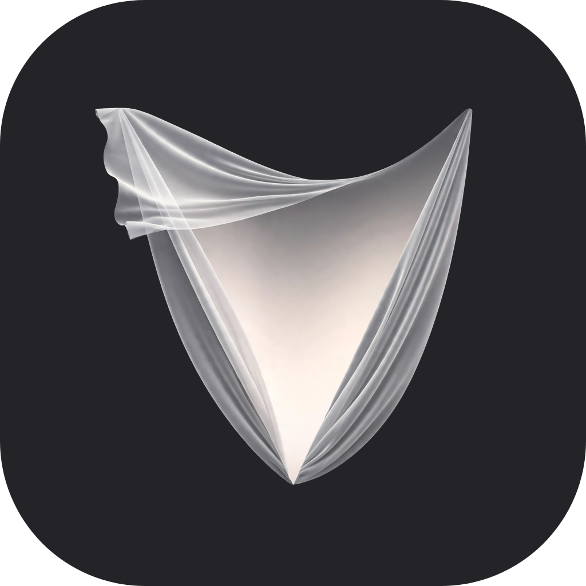

# Veil

  

Veil is a free macOS app for presenting on screen: choose the windows or
apps you want to show, arrange the canvas and camera, then share the
Capture Area window in Zoom, Google Meet, or Microsoft Teams. Veil is
written from scratch with SwiftUI and ScreenCaptureKit, with original
code.

The idea behind the name: a veil sits between your desktop and your
audience. Only what you lift the veil for is seen. Everything else —
other windows, notifications, private chats — stays behind it. Panic
drops the veil instantly.

## Features

- **Sources**: windows grouped by app, with search, Allow/Block List
  modes, Reset All Sources and Refresh. Windows that are minimised or
  on another Space are hidden, except a window in true fullscreen.
  Selecting a background app brings it forward.
- **Display**: choose the display to capture; the built-in display is
  the default and is never changed by a preset. Choosing No Display
  pauses the output.
- **Framing & Canvas**: framing Screen or Dynamic; canvas Full Display
  (the whole display) or Isolated (selected windows over a background:
  black, white, gray, or a custom image). A fullscreen source fills
  the display without the menu bar, and a fullscreen Brave window no
  longer shows a white bar on the right.
- **Presets**: two built-ins (Presentation, Meeting) plus your own.
  Custom presets appear as a horizontal strip with search;
  `Cmd+1`–`Cmd+9` apply the first nine. A preset stores the mode,
  framing, canvas, windows, camera, and active file.
- **Camera**: overlay with 9 positions, 3 shapes, size 50%–300%,
  mirror, and a device picker (built-in, external, iPhone Continuity
  Camera). On by default at size 110.
- **Files**: PDF (full page navigation) and PPT/PPTX (first-slide
  preview). The file controller pill has previous, page number, next,
  file list, page overview (thumbnail grid), and close — and never
  appears in the shared output. Pages can also be changed with the
  keyboard. Pickers open as a sheet attached to the panel.
- **Capture Area (Output)**: the window you share in Zoom, Meet, or
  Teams. It matches the Preview's size and ratio, can be resized by
  dragging its edges or corners, and can be dragged to the top of the
  screen to fill it. It starts hidden at launch.
- **Presentation timer**: a floating pill inside the Capture Area that
  counts up or down (countdown defaults to 30 minutes, presets 5–60
  minutes or custom).
- **Annotation & laser**: a floating pill next to the timer with Pen,
  laser, five colors, and Clear. Annotations are not saved.
- **Preview**: embedded above the panel, with the same content and
  ratio as the Capture Area. It is never shared.
- **Panic**: `Cmd+Shift+P` (or the Panic button) blanks the output
  instantly. Press again to resume.
- **Update check**: checks GitHub for a newer release shortly after
  launch, or any time from Veil menu > Check for Updates…

## Download

Download the latest release from the
[Releases page](https://github.com/aidilaryanto/veil/releases):
get the latest Veil DMG file, open it, and drag `Veil.app` into
Applications.

## "Veil is damaged and can't be opened"

If macOS refuses to open the app with "Veil is damaged and can't be
opened" or ""Veil" can't be opened because Apple cannot check it for
malicious software", do not delete it. This happens because the
GitHub Actions build is ad-hoc signed, not Developer ID signed and
notarized. Fix it with one of these:

**Option 1 — Terminal (fastest):**

1. Open Terminal.
2. Run:

   `xattr -dr com.apple.quarantine /Applications/Veil.app`

   (If Veil.app is somewhere else, use that path instead.)
3. Double-click Veil.app. It should now open normally.

**Option 2 — System Settings:**

1. Click Done on the error dialog.
2. Open System Settings > Privacy & Security.
3. Scroll down to the Veil message and click Open Anyway, then Open
   in the confirmation dialog.

Notes:

- On macOS Sequoia and later, right-click > Open does not bypass
  this check. Use one of the options above.
- You only need to do this once per downloaded build.
- A build made directly on your Mac (via Xcode or `swift build`)
  does not need any of this.

## How to build with Xcode

1. Open this project folder in Xcode, or run from Terminal:
   `swift build -c release`
2. Allow Screen Recording and Camera when the app first asks for them
   (System Settings > Privacy & Security).
3. The stream starts automatically. Choose windows in the Sources
   popup, then share the Capture Area window in Zoom/Meet/Teams.

## How to build with GitHub Actions

Every push to the `main` branch (or a manual trigger) runs the workflow
`.github/workflows/build-macos.yml`: it builds in release mode, wraps
the binary as `Veil.app` (bundle id `com.veil.app`, with the Veil icon
generated from `Assets/veil-icon.png`), signs it ad-hoc, then uploads
an artifact named `Veil-macOS`. Download that artifact from the Actions
tab of the repository and extract it.

## How to use

1. Choose windows in the Sources popup (or a PDF/PPT file).
2. Adjust Display, Framing, Canvas, and Camera if needed, or apply
   a preset.
3. Open the Capture Area with the Capture Area button in the header
   (the stream is already running).
4. In Zoom/Meet/Teams, choose Share Screen > Window > "Veil Output —
   share this window", not the whole display.
5. To hide the output instantly, press Panic (`Cmd+Shift+P`).
   Press Panic again (or the Play box) to resume.
6. For a PDF, change slides from the file controller pill, or with
   the keyboard: Right/Down/PageDown/Space for next,
   Left/Up/PageUp for previous.

## What is deliberately not included

- **No license system**: the app is free, with no license validation,
  keys, activation, or paid preset limits.
- **No virtual camera / DriverKit**: there is no virtual camera.
  What is shared is a regular Capture Area window.
- **No copied assets or branding from a reference app**: the name,
  icon, assets, and wording of other apps are not used here.
  Only the functional idea is reimplemented, with original code.
- **PPT is first-slide preview only**: macOS has no built-in
  per-slide renderer for PPT/PPTX, so what is shown is the QuickLook
  thumbnail. For full slide navigation, convert the PPT to PDF first,
  then add the PDF as a file source.
