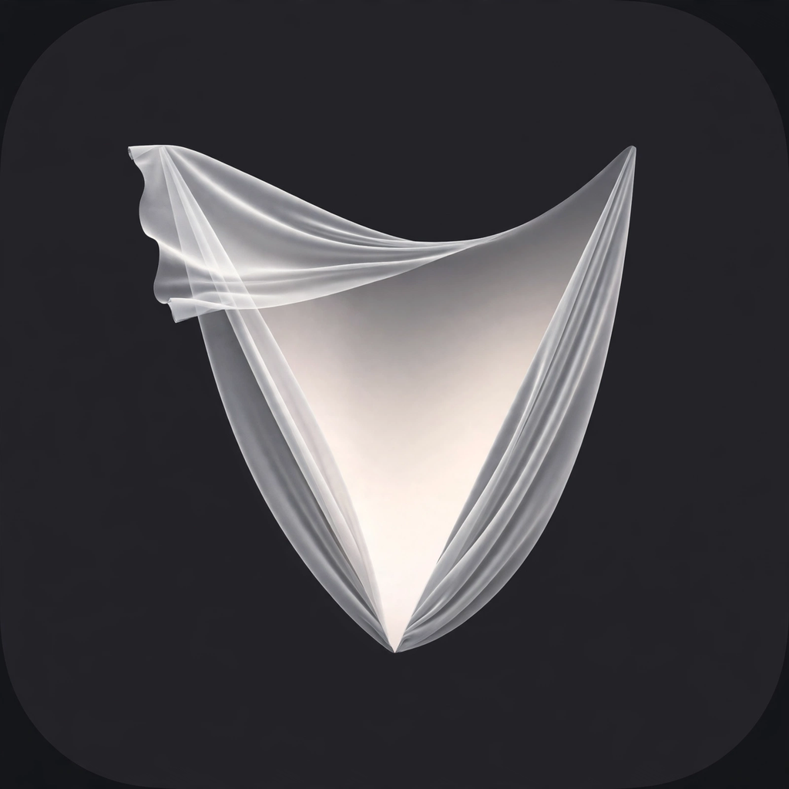

# Veil

Veil is a free macOS app for presenting on screen: choose the windows or
apps you want to show, arrange the canvas and camera, then share the
Output window in Zoom, Google Meet, or Microsoft Teams. Veil is written
from scratch with SwiftUI and ScreenCaptureKit, with original code.

The idea behind the name: a veil sits between your desktop and your
audience. Only what you lift the veil for is seen. Everything else —
other windows, notifications, private chats — stays behind it. Panic
drops the veil instantly.

## Features

- **Sources**: windows grouped by app, with search, Allow List and
  Block List modes, plus Clear and Refresh. The list refreshes every
  time Sources is opened, and includes windows that are minimized or
  on another Space, not just windows currently on screen. Windows with
  an empty title are shown under their app name.
- **Display**: choose the display to capture, with Full Display and
  Isolated explanations inside the popup.
- **Framing & Canvas**: framing Full (the whole display) or Dynamic
  (the capture area follows the combined frames of the selected
  windows); canvas Full Display or Isolated, with gray, white, black,
  or custom image backgrounds.
- **Presets**: no built-in presets — only presets you create yourself,
  which can be saved, applied, replaced, and deleted. A preset stores
  the mode, framing, canvas, windows, display, camera, and the active
  file. Presets are stored in UserDefaults under the key
  `Veil.v2.presets` (presets saved under the previous app name are
  migrated automatically on first launch).
- **Camera**: camera overlay with 9 positions, 3 shapes (circle, square,
  rounded), size 100–320, and a mirror option. The camera is on by
  default at size 110.
- **Files**: PDF sources (full page navigation via PDFKit) and
  PPT/PPTX sources (first-slide preview via QuickLook).
- **Panic**: the Panic button and the `Cmd+Shift+P` shortcut black out
  the output and stop capture immediately.
- **Always on Top**: the control window floats by default, while the
  Output window stays normal so it does not cover other work.
- **Shortcuts**: `Cmd+Shift+P` for Panic, `Cmd+Shift+S` for
  Start/Stop Stream.

## How to build with Xcode

1. Open this project folder in Xcode, or run from Terminal:
   `swift build -c release`
2. Allow Screen Recording and Camera when the app first asks for them
   (System Settings > Privacy & Security).
3. Press Refresh, choose a window, press Start Stream, then open Preview.

## How to build with GitHub Actions

Every push to the `main` branch (or a manual trigger) runs the workflow
`.github/workflows/build-macos.yml`: it builds in release mode, wraps
the binary as `Veil.app` (bundle id `com.veil.app`, with the Veil icon
generated from `Assets/veil-icon.png` when that file is present),
signs it ad-hoc, then uploads an artifact named `Veil-macOS`.
Download that artifact from the Actions tab of the repository, extract
it, then right-click > Open on first launch (an ad-hoc signature is
not a Developer ID signature).

## How to use

1. Press Refresh and choose windows in the Sources popup.
2. Adjust Display, Framing, Canvas, and Camera if needed, or apply
   a preset.
3. Press Start Stream, then press Preview to open the
   "Veil Output — share this window" window.
4. In Zoom/Meet/Teams, choose Share Screen > Window > that Output
   window, not the whole display.
5. To hide the output instantly, press Panic
   (`Cmd+Shift+P`). Press Start Stream again to resume.

## What is deliberately not included

- **No license system**: the app is free, with no license validation,
  keys, activation, or paid preset limits.
- **No virtual camera / DriverKit**: there is no virtual camera.
  What is shared is a regular Output window.
- **No copied assets or branding from a reference app**: the name,
  icon, assets, and wording of other apps are not used here.
  Only the functional idea is reimplemented, with original code.
- **PPT is first-slide preview only**: macOS has no built-in
  per-slide renderer for PPT/PPTX, so what is shown is the QuickLook
  thumbnail. For full slide navigation, convert the PPT to PDF first,
  then add the PDF as a file source.
